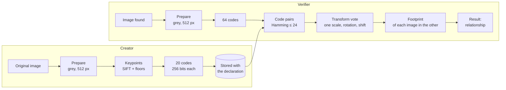
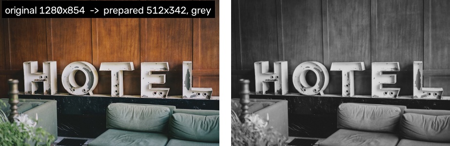
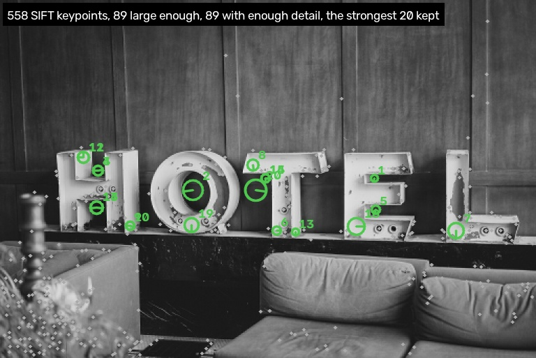
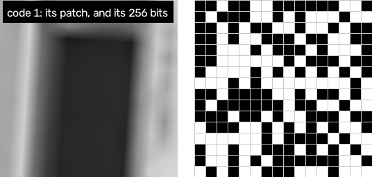
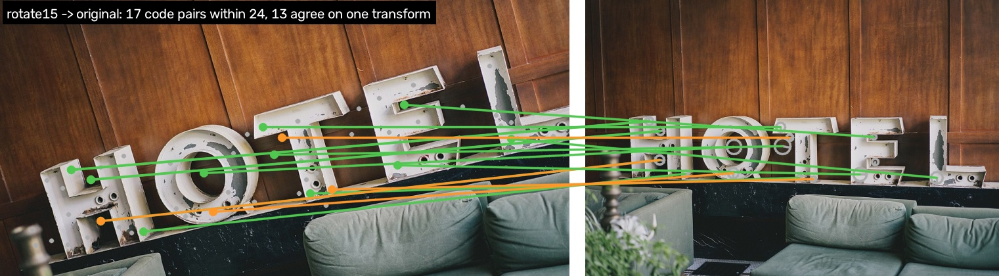
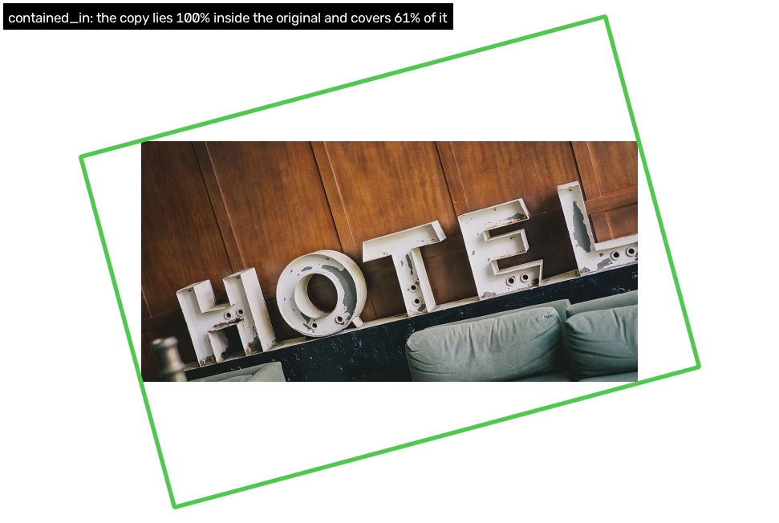
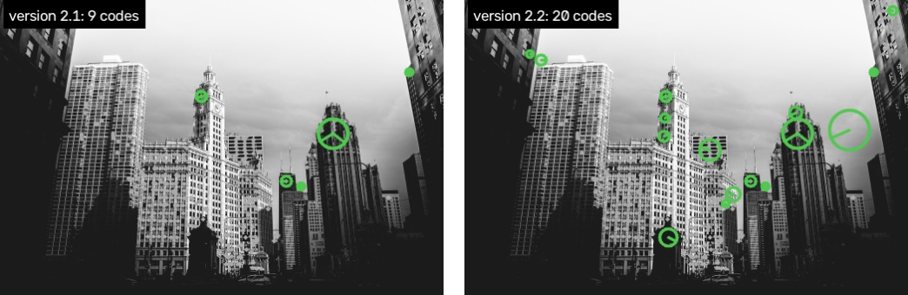
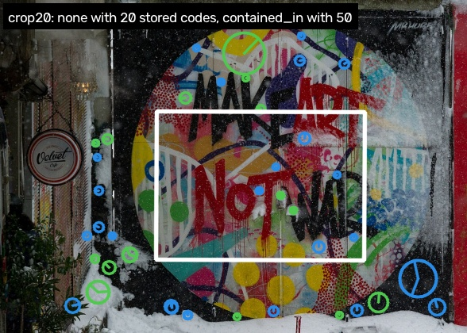
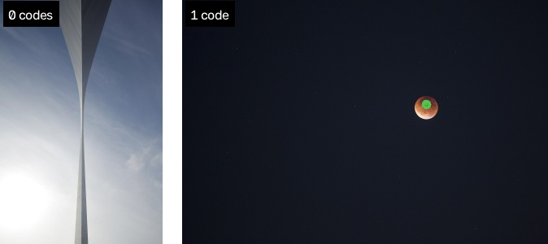
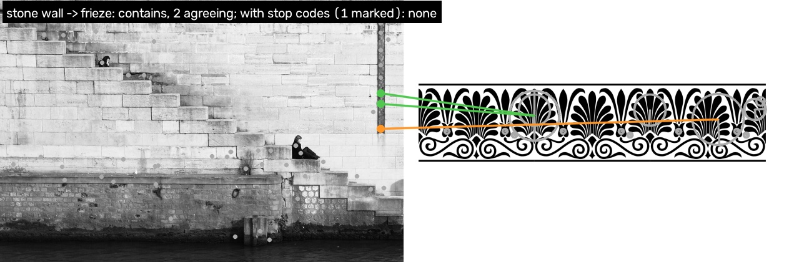

# How matching works, step by step

One photo from the test split (a HOTEL sign, `s015.jpg`) is declared. One of
test mode's copies is checked against it: the photo rotated 15° and cropped to
the largest upright rectangle inside. The figures come from
[`docs/demo/make.py`](docs/demo/make.py).



## Creator: declaring the image

### 1. Preparation



The image is decoded and reduced to what the codes need:

- **Decoded as the browser does.** EXIF orientation is applied, colour
  profiles are ignored, and transparency is flattened onto white.
- **Grey, 512 px.** The image is converted to grey and scaled so its longer
  side is 512 px. It is never scaled up.

### 2. Keypoints



SIFT finds up to 1,500 keypoints: spots that look distinctive at some size. Then:

- **Small keypoints are dropped.** A keypoint less than 2% of the short side
  across (grey dots) describes too little to survive resizing and re-encoding.
- **The 512 strongest are considered**, by SIFT's response.
- **Flat patches are dropped.** A patch with too little texture gives an
  unreliable code (orange circles; none here).
- **The strongest 20 are kept** (green, numbered by rank). The circle shows the
  patch's size and the line its orientation.

### 3. Codes



Each keypoint's SIFT descriptor (128 numbers, computed at the scale it was found
at) is projected to 256 numbers with a fixed matrix, and each is compared with a
fixed threshold: one bit each. Two codes of the same patch differ in a few bits
after resizing or re-encoding; codes of different patches differ in about half.

The declaration stores the 20 codes, each with its position, size and angle:

```json
{"chunk_idx": 0, "code": "d9f9b944d64bd3b3c5d1c0bb…", "x": 0.699, "y": 0.497, "scale": 0.020, "angle": 266.31}
```

## Verifier: checking an image

### 4. Code pairs and the transform vote



The image found gets up to 64 verifier codes (grey dots, left). It takes more
codes than the creator stores, so that its strongest 20 need not be the same as
the original's.

1. **Code pairs:** every verifier code within Hamming distance 24 of a stored
   code. Here there are 17.
2. **Vote:** each pair implies a scale, a rotation and a shift from the original
   to the copy. Pairs are counted in bins of those three, and the fullest bin
   wins: 13 pairs agree (green). The other 4 are chance agreements that point
   elsewhere (orange).
3. **At least 2** agreeing codes are needed for a match.

### 5. Footprint



The agreeing pairs give one similarity transform (least median of squares). It
carries the original's outline into the copy (green). The relationship then
comes from how much of each image lies inside the other:

| | copy covered by the original | original covered by the copy |
| --- | --- | --- |
| `identical` | 95% or more | 95% or more |
| `contained_in` | 95% or more | less |
| `contains` | less | 95% or more |
| `overlapping` | less | less |

A last check refuses agreeing codes bunched in one spot: they must spread over
at least 5% of the overlap's side.

### 6. Result

```json
{"relationship": "contained_in", "overlap_fraction": {"verifier": 1.0, "candidate": 0.6062}, "agreeing_codes": 13}
```

The copy lies wholly inside the original and shows 61% of it. Other test mode
copies of the same photo:

| copy | relationship | agreeing codes | overlap (copy, original) |
| --- | --- | --- | --- |
| JPEG quality 60 | `identical` | 20 | 1.0, 1.0 |
| 50% crop | `contained_in` | 6 | 1.0, 0.50 |
| filling half a collage | `contains` | 5 | 0.50, 1.0 |
| the original, checked against that collage | `contained_in` | 9 | 1.0, 0.50 |
| two crops sharing half their area | `overlapping` | 4 | 0.50, 0.50 |

```python
from image_simprints import generate, match

stored = generate("original.jpg", "creator")       # at declaration
result = match(generate("found.jpg", "verifier"), stored)
```

## Harder cases

Numbers in this part are from the test split at default settings
([report](tests/corpus/report-v2.2/summary.md)): 150 originals, 3,750 copies,
1,000 unrelated photos.

### 7. Fine detail: the size floor first

**The problem.** In a photo crowded with fine detail (windows, foliage, carving,
small text) nearly all of the 512 strongest keypoints are small. Before version
2.2 the size floor came after that cut, so few keypoints were left: this
skyline (`s131.jpg`) kept only 9 codes. 111 of the 2,618 corpus photos have
fewer than 10 large keypoints among their strongest 512.



**The fix.** Version 2.2 drops the small keypoints first and takes the 512
strongest of the rest. Grey dots are the 512 strongest keypoints overall; green
circles are the codes kept.

**Results.**

- The skyline keeps 20 codes, and 18 of its 25 test copies are found, against 16.
- The 8 test originals with fewer than 10 large keypoints go from 25% of copies
  found to 31%.
- All copies: 68.9%, against 67.9%; 50% crops 82%, against 77%.

### 8. Small pieces: more stored codes

**The problem.** A small crop, or a picture filling a small part of a collage,
holds only the stored codes that fall inside it. In this 20% crop of a mural
(`s002.jpg`), 5 of the 20 stored codes (green) lie inside the crop (white).
Cropped and scaled up, only 1 of them still agrees: `none`.



**The fix.** Store more codes: `generate(image, "creator", {"creator_codes": 50})`.
With the next 30 (blue), 12 lie inside and 4 agree: `contained_in`. The version
string records the setting (`image-simprints/2.2;creator_codes=50`).

| | 20 stored codes (default) | 50 stored codes |
| --- | --- | --- |
| 30% crops found | 44% | 75% |
| 20% crops found | 21% | 47% |
| 15% of a collage found | 29% | 49% |
| all copies found | 68.9% | 78.8% |
| false matches | 40 | 54 |
| look-alike false matches | 6 | 8 |
| code bits stored per image | 640 bytes | 1,600 bytes |

More stored codes find more small pieces, at the cost of more storage and more
chance agreements.

### 9. Flat images: nothing to code



**The problem.** An image with little texture has few keypoints that pass the
floors. The pale sky (`s042.jpg`) gets no codes, with the reason `no keypoints
with enough detail`. The moon (`s126.jpg`) gets 1, and a match needs 2
agreeing codes.

**What can be done.** Nothing in the codes. These are the 4 test originals not
found even as an identical copy, which is why re-encodes and resizes stop at
97%. Treat a result with fewer than 2 codes as "cannot be checked" rather than
as "no match".

### 10. Repeated patterns: stop codes

**The problem.** A pattern that repeats looks the same in many pictures. The
water-level gauge on this river wall (`s067.jpg`, a column of repeated marks)
matches the palmettes of a frieze graphic (`u0330.jpg`): `contains`, with 2
agreeing codes. The two photos have nothing to do with each other. It is the
only false match between truly unrelated photos on the test split at default
settings; the others are duplicates, the same picture or the same scene.



**The fix: mark codes that match too many pictures.** As stop words are
ignored in text search:

1. **Compare each stored code with the collection.** A code that agrees with
   codes of more than one other picture (N = 1, Hamming distance ≤ 28) is
   marked as a stop code.
2. **`match` ignores marked codes.** Here 1 of the frieze's 20 codes is marked
   (orange); green pairs are codes that stay. Fewer than 2 agreeing codes
   remain: `none`.

```python
from image_simprints.recipe import mark_stop_codes

GUARD = {"tolerance_t": 28}                      # fitted together with N = 1
stored = mark_stop_codes(stored, 1, GUARD, against=one_per_picture)
result = match(query, candidate, GUARD)
```

| | copies found | false matches | truly unrelated | look-alikes |
| --- | --- | --- | --- | --- |
| no stop codes (default) | 68.9% | 40 | 1 | 6 |
| **stop codes, N = 1, t = 28** | **70.2%** | **36** | **0** | **6** |

Stop codes are an index-side option: [INTEGRATION.md](INTEGRATION.md) covers
counting each picture once, keeping the marks current, and refitting N for a
larger collection ([report](tests/corpus/report-v2.2-guard/summary.md)).

To regenerate the figures, run `fetch-corpus`, then:

```bash
python docs/demo/make.py
```
